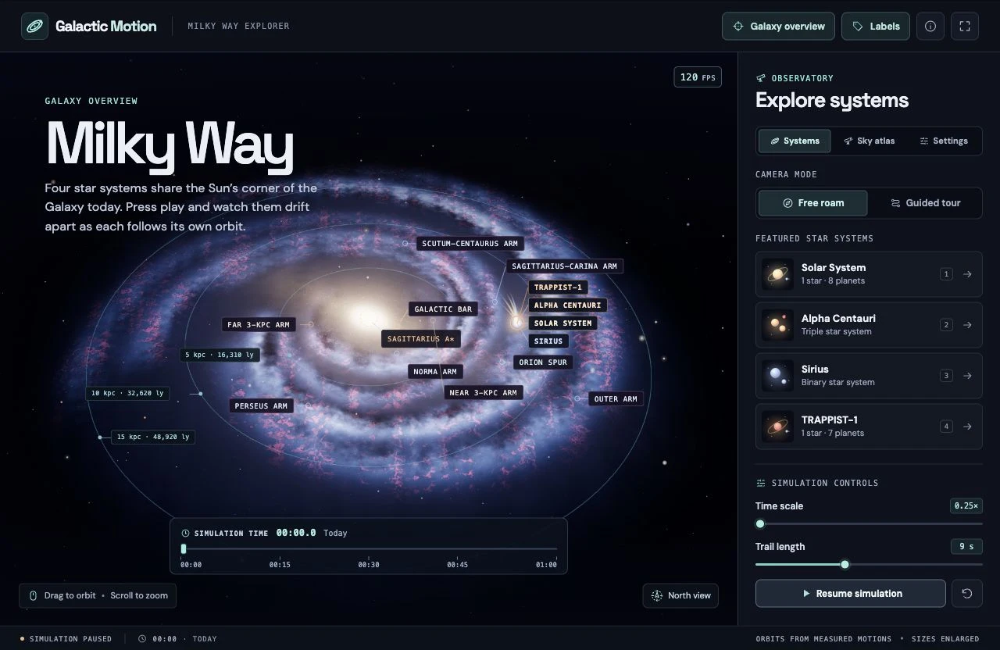
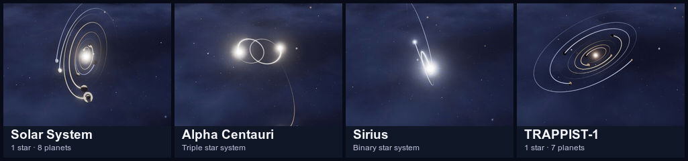
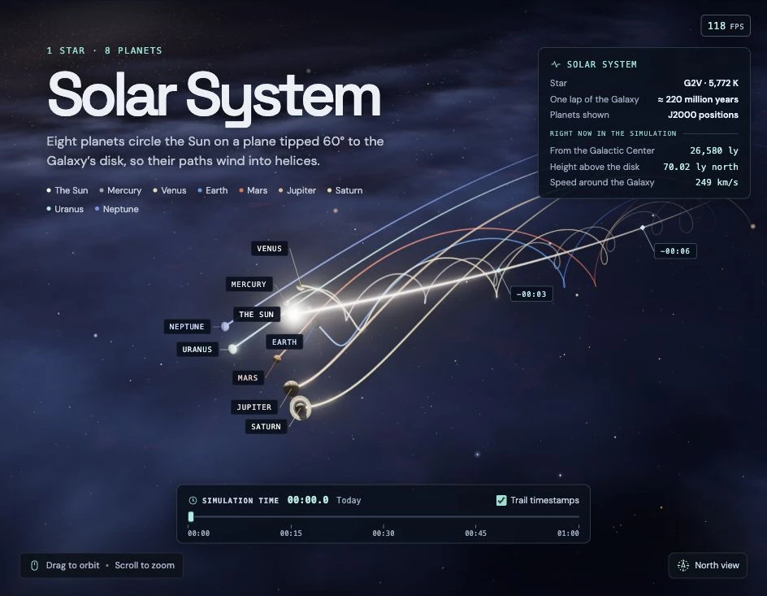
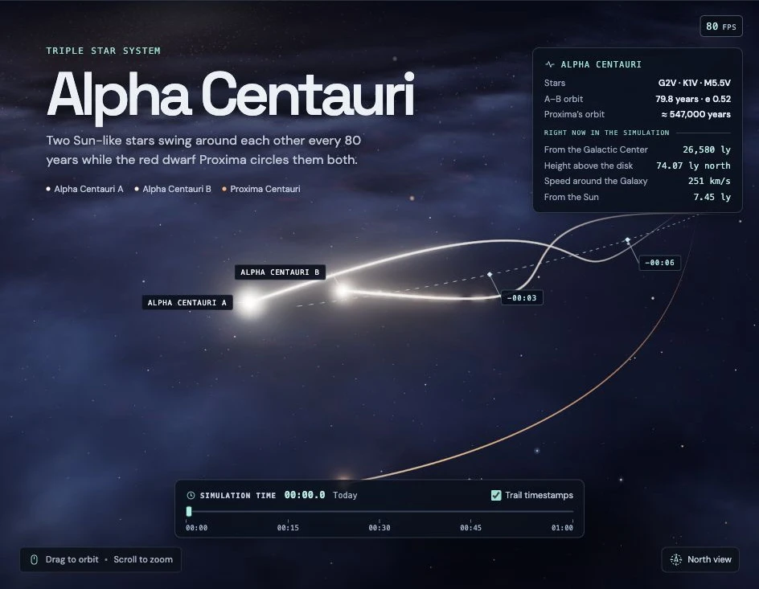
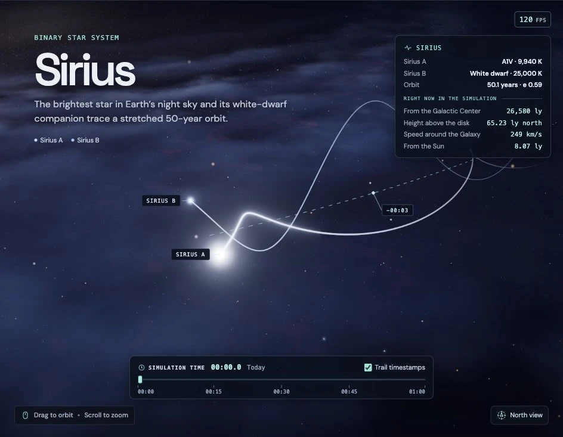
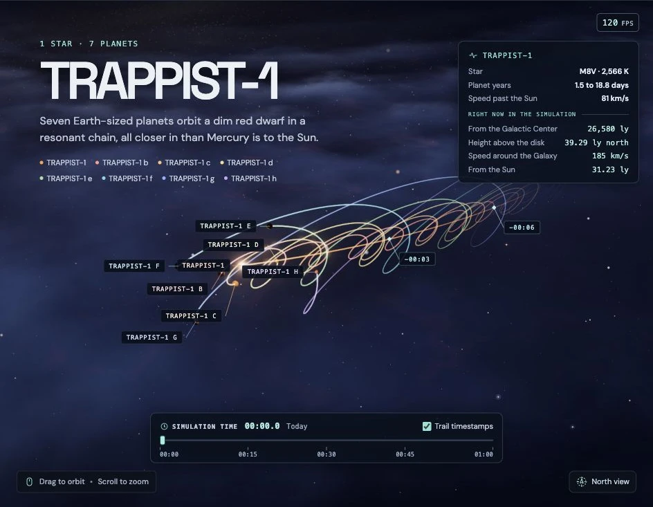
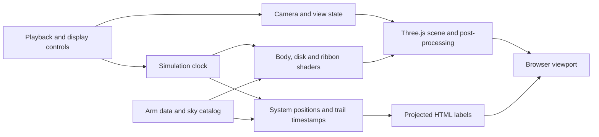

# Galactic Motion

Galactic Motion is a browser-based 3D explorer of the Milky Way. Follow the Solar System, Alpha Centauri, Sirius, and TRAPPIST-1 around the galactic center on orbits computed from their measured positions and velocities, watch their planets and companion stars trace helices, or switch to the Sky atlas to look outward from the Sun.



## Four star systems in motion

The side-by-side animation uses **System-centered orbits** to show the local motion of planets and companion stars. The screenshots below show the same systems in the **Galactic path** view, with trails following the systems through the Milky Way.



| Solar System | Alpha Centauri |
| --- | --- |
| [](docs/media/solar-system.webp) | [](docs/media/alpha-centauri.webp) |

| Sirius | TRAPPIST-1 |
| --- | --- |
| [](docs/media/sirius.webp) | [](docs/media/trappist-1.webp) |

## Credits and citation

Sai Gattupalli, PhD, made Galactic Motion with Opus 5.5, using the iterative prompting techniques described in the following paper.

Gattupalli, S., & Chakravarty, P. (2025). *Prompting the Universe: AI-Generated Physics Simulations for Engaged Learning*. ScholarWorks@UMassAmherst. [DOI 10.7275/bddm-yf93](https://doi.org/10.7275/bddm-yf93)

## What is measured and what is enlarged

| Part of the model | Status |
| --- | --- |
| Where the four systems are | Real. All four lie within 41 light-years of the Sun, so at the scale of the Galaxy they start in one spot. |
| Their paths around the Galaxy | Integrated from each system’s measured position and space velocity in a potential with a flat 236 km/s rotation curve. They drift apart as you play, because each star follows its own orbit. |
| Time | One simulation second spans about 1.36 million years of galactic motion. The clock starts at the year 2000. |
| Orbital planes, eccentricities, and starting positions in the close-ups | Real, taken from published orbital elements for the J2000 epoch. |
| Sizes of stars, planets, and their orbits | Enlarged by many orders of magnitude so that they can be seen. The Solar System’s spacing is compressed, and TRAPPIST-1’s orbits are to scale with one another. |
| Speed of planets and companion stars | Sped up enormously relative to galactic time. Each system keeps Kepler’s third law for the orbit sizes it draws. |
| Spiral arms near the Sun | Fitted to maser distances. The far side of the Galaxy is inferred. |
| Star colors | Computed from temperature. Planet surfaces are procedural, and TRAPPIST-1’s planet colors are labels. |

## Which Milky Way am I seeing?

The **3D disk** and the **photographic band** are two views of the same galaxy. The wide, pale band with dark streaks in the Sky atlas comes from ESO’s 360° photograph of the sky **as seen from Earth inside the Milky Way**. The pale light is the combined light of the disk’s stars, and the bright central region is the galactic bulge. Dark lanes come from foreground dust absorbing starlight. [ESO’s Milky Way panorama](https://www.eso.org/public/images/eso0932a/)

| View | What the camera shows | What appears behind it |
| --- | --- | --- |
| Galaxy overview and North view | The modeled 3D disk, central bar, named arms, distance rings, and one marker and trail for each system | A dark sky, optional decorative star points, and optional telescope portraits of more distant galaxies |
| System close-up | A moving camera follows one system’s center of mass while its planets or companion stars trace their paths | The same modeled disk and background layers, dimmed |
| Sky atlas | A catalog direction as seen from the Sun today | The optional ESO sky photograph and an optional enlarged telescope portrait of the selected object |
| Static preview | An illustrated galaxy image when WebGL 2 is unavailable or the renderer stops. While the renderer loads, the stage stays dark. | The packaged preview image |

## Run locally

Use Node.js 22.12 or later and npm. The package also declares support for Node.js 20.19 through the 20.x series.

```sh
cd ~/Documents/GitHub/Galactic-Motion-Sim
npm ci
npm run dev
```

Open [http://localhost:5173](http://localhost:5173), or follow the address Vite prints when the default port is occupied. Run the commands from the directory containing this project’s `package.json`.

| Command | Purpose |
| --- | --- |
| `npm ci` | Install the exact dependency versions from the lockfile |
| `npm run dev` | Start the local Vite server with hot updates |
| `npm run typecheck` | Check the TypeScript sources and tests without emitting files |
| `npm test` | Run the unit tests for the orbital, coordinate, and timing code |
| `npm run build` | Type-check, run the tests, and generate static production files in `dist` |
| `npm run preview` | Serve the existing production build locally, usually at port 4173 |

## Controls and navigation

- **Systems** lists the four systems. Select a card, a projected marker, or press **1**–**4** to track one. Drag to orbit the camera and scroll or pinch to zoom. Zooming in closes on the star itself, and planets grow into shaded globes.
- The **data card** beside a tracked system lists a few facts and four live figures: distance from the Galactic Center, height above the disk, speed around the Galaxy, and distance from the Sun.
- **Galaxy overview** or **G** returns to the oblique view. **North view** or **N** looks down onto the disk from galactic north, where clockwise rotation is apparent.
- **Labels** or **L** toggles projected names for systems, bodies, the galactic map, and deep-sky objects. Separate arm and deep-sky label switches appear in **Settings**. Labels move aside or disappear when they would overlap each other or the interface panels.
- **Guided tour** or **T** visits each system with a short narration and loops every 56 seconds. Interacting with the scene or choosing a system manually returns the camera to free roam.
- **Sky atlas** points the camera toward an object’s catalog coordinates. Drag to look around, use the **Field of view** slider, the scroll wheel, or a trackpad pinch to zoom, and open **Milky Way map key** for the full list of arm names.
- **Pause simulation** or **Space** freezes the simulation clock while leaving the camera available. Keyboard shortcuts yield to text fields, menus, and the About dialog. If reduced motion is enabled at startup, playback starts paused and camera transitions snap to their destinations.
- **Reset simulation** restores the timer and scrubber, time scale, trail length, and overview framing. Display settings are independent of the simulation reset.

### Simulation controls

| Control | Default | What it changes |
| --- | --- | --- |
| Time scale | 0.25× | Advances the simulation clock at 0.25× to 4× in 0.25× steps |
| Trail length | 9 seconds | Changes the sampled history window from 2 to 20 simulation seconds, or about 3 to 27 million years |
| Simulation time | 00:00.0 | Scrubs in tenths of a simulation second and shows the matching span of galactic time. Seeking pauses playback and ends a guided tour. The range starts at 60 seconds and expands in 60-second increments as playback reaches its end. |
| Trail timestamps | On | In a tracked system’s galactic frame, marks earlier times along its path. Negative timestamps are positions before the year 2000. |
| Trail reference frame | Galactic path | **Galactic path** includes the system’s travel around the Milky Way. **System-centered orbits** holds the system’s center of mass fixed, which shows the true ellipses. |
| Orbit trails | On | Shows or hides the ribbons and their time guides. The bodies continue moving. |
| Distance rings | On | Shows or hides rings 5, 10, and 15 kiloparsecs from the center in overview and North view |

### Visual settings

| Control | Default | What it changes |
| --- | --- | --- |
| Bloom intensity | 50% | Brightens luminous pixels with an HDR bloom pass on supported GPUs. At 0%, the pass is skipped. |
| Disk glow and dust | 100% | Scales the brightness of the disk’s diffuse light and core glow |
| Render quality | Auto | Chooses adaptive resolution, Performance, or High detail |
| Spiral arm labels | On | Shows named structures when viewing the full modeled disk |
| Deep-sky labels | On | Shows names for visible catalog objects |
| All-sky photograph in atlas | On | Shows the ESO panorama when an atlas object is selected |
| Telescope close-ups | On | Shows enlarged galaxy portraits in the atlas and portraits of distant galaxies in model views |
| Background stars (decorative) | On | Draws procedural star points behind the modeled disk |
| Field of view | Object-specific | Changes the atlas camera’s vertical field of view from 3° to 60° |

The FPS counter in the upper right reports measured animation frames per second, independently of the simulation’s 120 Hz clock.

## Technology stack

| Technology | Role |
| --- | --- |
| TypeScript 5.9 | Strictly typed application code, compiled for ES2022 with bundler module resolution |
| Vite 8 and Rolldown | Development server, production bundling, and asset processing. The 3D simulator loads dynamically, and Three.js core is split into its own chunk. |
| Three.js r184 | WebGL renderer, scene graph, cameras, matrices, instanced geometry, texture loading, and built-in post-processing |
| WebGL 2 and GLSL ES 3.00 | GPU evaluation of galactic and Keplerian orbits, star motion, the disk’s diffuse light, planet surfaces, and sky-image projection |
| `OrbitControls` | Drag, wheel, and touch camera input with damping, a movable target, and scene-dependent zoom behavior |
| `EffectComposer`, `RenderPass`, `UnrealBloomPass`, `SMAAPass`, `OutputPass` | Render the HDR scene, diffuse bright regions, smooth edges, and apply ACES filmic tone mapping with sRGB output |
| HTML, CSS, native DOM events and ranges | Responsive controls, accessible buttons and settings, an About dialog, projected labels, the time scrubber, and viewport overlays |
| Fontsource, DM Sans and Space Grotesk | Self-hosted Latin-subset variable fonts for the interface |
| WebP | Local, compressed sky photographs, telescope portraits, and the static preview |
| OpenAI ImageGen | Created the illustrated fallback image during development. The atlas uses the credited observations below. |
| Vitest | Unit tests for the orbit integration, coordinate frames, orbital elements, and timing |
| Node.js and npm | Local development, package management, and production builds |
| Vercel | Static hosting for the compiled Vite output |

## How the simulation works



### World coordinates, units, and galactic orbits

The `XZ` plane is the galactic disk, the origin is the galactic center, and positive `Y` points toward galactic north. A rising azimuth moves from positive `X` toward positive `Z`, which appears clockwise from the north pole. The Sun starts 132 scene units from the center, which stands for 8.15 kiloparsecs, and a circular orbit covers 5.3 units per simulation second, which stands for 236 km/s. Those two choices fix the time scale at about 1.36 million years per simulation second. [Reid et al. (2019)](https://arxiv.org/abs/1910.03357)

Each system’s orbit starts from its measured place and motion.

| System | Galactic longitude, latitude | Distance | Velocity relative to the Sun (U, V, W) |
| --- | --- | --- | --- |
| Solar System | | 0 | 0, 0, 0 km/s |
| Alpha Centauri | 315.73°, −0.68° | 4.34 light-years | −29.3, +1.7, +13.6 km/s |
| Sirius | 227.23°, −8.89° | 8.60 light-years | +14.4, −0.3, −11.5 km/s |
| TRAPPIST-1 | 69.71°, −56.64° | 40.7 light-years | −44.0, −66.7, +10.7 km/s |

U points toward the galactic center, V along the direction of rotation, and W toward the north galactic pole. The velocities come from each system’s proper motion, parallax, and radial velocity, and the TRAPPIST-1 values agree with [Burgasser and Mamajek (2017)](https://arxiv.org/abs/1706.02018). The Sun’s own motion relative to a circular orbit, (11.1, 12.24, 7.25) km/s from Schönrich, Binney, and Dehnen (2010), is added to all four, and the Sun starts 20.8 parsecs north of the mid-plane (Bennett and Bovy 2019).

`galactic-orbit.ts` integrates each star’s motion in the plane with a fourth-order Runge–Kutta scheme, in a potential whose rotation curve is flat at 236 km/s. In such a potential the radius repeats exactly after one radial period and the azimuth advances by a fixed angle, so the module stores each orbit as two eight-term Fourier series in the radial phase. The shaders and the CPU evaluate the same series, so the path costs no memory as time grows and can be evaluated at any time, including before the year 2000. Motion through the disk is a separate harmonic oscillation at 70 km/s per kiloparsec (Binney and Tremaine 2008), which gives the Sun a period of about 88 million years and a reach of about 100 parsecs.

The model’s limits are these: the potential is smooth and axisymmetric, so the bar and arms do not tug on the stars, the vertical frequency does not change with radius, and the measured velocities carry uncertainties that grow into large position errors over hundreds of millions of years. The paths show how each star’s present motion would carry it. They are not a forecast.

### Named spiral structure

Galactic azimuth is measured from the Sun–center line at the year 2000 in the direction of rotation. Within the fitted intervals, each arm’s centerline comes from a piecewise logarithmic spiral around the radius and azimuth of its fitted bend.

```text
R(beta) = Rkink * exp(-(beta - betaKink) * tan(pitch))
```

The renderer evaluates the two pitch angles on the appropriate sides of the bend. It continues shortened fits with tapered, broader arms on the far side. The **Norma**, **Scutum–Centaurus**, **Sagittarius–Carina**, **Perseus**, and **Outer** arms and the **Orion Spur (Local Arm)** draw on the measured segments in Reid et al. The near and far **3-kpc arms** are schematic inner gas lanes. The central bar starts about 30° from the Sun–center line, and the **Sagittarius A*** marker indicates the galactic center. [Reid et al. (2019), Table 2](https://arxiv.org/abs/1910.03357) · [Wegg et al. (2015)](https://doi.org/10.1093/mnras/stv745) · [NASA’s Milky Way illustration](https://science.nasa.gov/resource/the-milky-way-galaxy/)

Stars and patterns move at different rates. Disk stars share one orbital speed, so stars nearer the center lap those farther out. The spiral pattern turns at 28.2 km/s per kiloparsec, which nearly matches the Sun’s angular speed, so the Sun lingers near the Local Arm while inner stars overtake the arms. The bar and the lanes inside 4.1 kiloparsecs turn faster, at 39 km/s per kiloparsec. Whether the Milky Way’s arms are long-lived patterns at all is still debated. [Dias et al. (2019)](https://arxiv.org/abs/1905.08133) · [Portail et al. (2017)](https://arxiv.org/abs/1608.07954)

`spiral-map.ts` rasterizes the arm profiles into a 512 × 256 polar data texture. Its channels encode arm ridges, broader halos, and offset dust lanes. The disk-point and diffuse-light shaders sample the same texture. A seeded generator lays out 150,000 stars: a long thin bar inside a thicker bulge, an exponential disk with a 2.9-kiloparsec scale length, and the arms. Their colors come from black-body temperatures drawn for each population, with a modest saturation lift: old giants in the bar, mixed stars in the disk, and hot young stars in the arms. Three horizontal shader layers add the unresolved starlight, blue light from young stars, pink knots of ionized hydrogen, and dust lanes that dim and redden the light behind them.

### Local orbits and surface rotation

Each body follows one or two Keplerian ellipses about its system’s center of mass. The vertex shader solves Kepler’s equation with five Newton steps and places the body with two unit vectors, one toward periapsis and one a quarter turn ahead.

```text
M(t) = meanMotion * t + M0            E - e * sin(E) = M
offset(t) = a * ((cos(E) - e) * P + sqrt(1 - e^2) * sin(E) * Q)
body(t) = center(t) + offset(t) + optionalOuterOffset(t)
```

`P` and `Q` are computed once from published orbital angles and rotated into the scene, so each orbital plane keeps its real orientation as the system travels.

| System | Bodies | Source and treatment |
| --- | --- | --- |
| Solar System | The Sun and eight planets | [JPL approximate elements](https://ssd.jpl.nasa.gov/planets/approx_pos.html) at J2000: eccentricity, inclination, node, perihelion, and starting position. The ecliptic is tipped 60° to the galactic plane. Radii are compressed, and periods follow Kepler’s third law for the drawn radii, with Earth taking 3.6 seconds. |
| Alpha Centauri | A, B, and Proxima | A and B follow the 79.8-year orbit of [Akeson et al. (2021)](https://arxiv.org/abs/2104.10086) with eccentricity 0.52, split by their masses. Proxima’s plane and present position come from the offset and velocity in [Kervella et al. (2017)](https://arxiv.org/abs/1611.03495), with eccentricity 0.50. Its 547,000-year orbit is drawn closer in and faster than scale. |
| Sirius | Sirius A and Sirius B | The 50.1-year orbit of [Bond et al. (2017)](https://arxiv.org/abs/1703.10625) with eccentricity 0.59, split by the stars’ masses |
| TRAPPIST-1 | The star and planets b through h | Periods, orbit sizes, and planet radii from [Agol et al. (2021)](https://doi.org/10.3847/PSJ/abd022), drawn to scale with one another and nearly edge-on to the Sun. The orientation of the plane around the line of sight and the starting phases are not measured. |

Binary stars move at one second per decade. The unit tests check the model against observation: Alpha Centauri B appears 14.1″ from A at position angle 222° in 2000, and Sirius B 4.5″ from A at 151°.

Stars are luminous billboards whose colors come from their surface temperatures, with a limb-darkened disk in close-up. Planets are solid: they hide what lies behind them and show phases lit from their star. The Solar System’s planets get procedural surfaces in their real colors, Saturn’s rings have the Cassini division and carry the planet’s shadow, and spin axes point at the IAU pole directions, with Venus and Uranus turning backwards. TRAPPIST-1’s planets are plain rock lit by their star’s red light and keep one face toward it. Spin rates are illustrative. [NASA Planetary Fact Sheet](https://nssdc.gsfc.nasa.gov/planetary/factsheet/index.html)

### Clock, trails, and timing

The clock represents time as 1/120-second ticks plus a fractional remainder. Each animation callback advances it by elapsed browser time, multiplied by the selected rate. Raw playback deltas are capped at 0.05 seconds, and hidden tabs skip animation work. A seek sets the clock directly and reevaluates the scene at the selected time.

The GPU draws one instanced ribbon mesh, one instanced star mesh, and one instanced planet mesh across the four systems. The overview draws a single marker and trail for each system, and a close-up draws only its own 22 or fewer bodies. Each ribbon strip has 512 samples, two vertices per sample, and indexed triangles. The vertex shader evaluates each point at `time − age × trailLength`. A nearby sample estimates the screen-space tangent so the strip can widen perpendicular to the path. The fragment shader tapers the tail and boosts brightness near the body. The renderer recomputes paths analytically, so trail memory stays fixed even as playback time grows.

Every 128 simulation seconds, the renderer moves the shader’s time origin forward and rebases its phase attributes. That keeps the GPU time values small while the UI and CPU positions continue using absolute simulation time. Seeking backwards also updates the shader’s time origin.

In the system-centered view, the selected system’s past center of mass is subtracted and its current one is added. The ribbons then show the ellipses themselves. Single orbits are capped at one revolution in this view to limit brightness from overlapping loops. Up to four projected timestamps mark the center of mass’s past positions in the galactic frame, along a dashed guide where no star sits at the center.

### Camera and tour

The simulation camera uses a perspective projection and damped orbit controls. During system tracking, the CPU evaluates the center of mass with the same series as the GPU and moves the camera with it. The camera pivots on a point slightly behind the system so that the trail fills the frame, and that offset shrinks as the camera closes in. The camera also turns with the system’s direction of travel, so the trail keeps its place in the frame however far the clock runs or is scrubbed. Camera transitions ease over approximately 1.55 seconds, and the user can interrupt a model-view transition by interacting with the canvas.

| Guided tour time | Camera target |
| --- | --- |
| 0–8 seconds | Milky Way overview |
| 8–18 seconds | Solar System |
| 18–27 seconds | Alpha Centauri |
| 27–35 seconds | Sirius |
| 35–44 seconds | TRAPPIST-1 |
| 44–56 seconds | Return to the overview |

The tour runs on camera time. Changing simulation speed scales the orbits and trail clock while the tour keeps its camera pacing. Pausing the simulation holds the tour. The Sky atlas switches to a near-Sun viewing direction and changes the camera’s vertical field of view for zoom.

### Labels and render quality

The CPU samples system and body positions for the labels, projects them through the camera, and positions HTML callouts in screen space. The callout layout reserves rectangles for occupied labels and for the interface panels drawn over the scene, tries offsets on either side of each projected position, and draws the connector back to the point. The labels and controls remain in CSS pixels as the WebGL resolution changes.

Auto quality starts with a budget of roughly 1.75 million render pixels and monitors a smoothed frame duration. Under sustained load it steps down the effective device-pixel ratio. At lower scales it also reduces disk particle density and the number of visible dust layers. **Performance** targets roughly 950,000 render pixels, draws 75,000 disk particles, uses one dust layer, and skips SMAA. **High detail** targets up to roughly 3 million render pixels with 150,000 disk particles and three dust layers. The optional decorative field contains 10,000 seeded star points.

HDR-capable WebGL 2 devices use floating-point render targets for bloom and subpixel morphological antialiasing (SMAA). The compatible fallback uses an 8-bit render target. If the WebGL context cannot start or is lost, the app displays the static preview and disables the simulation controls.

## Sky atlas data and imagery

The catalog stores ICRS right ascension and declination in degrees, a display name, an approximate distance, a default field of view, an image aspect ratio, the kind of light each portrait records, and image credits. The coordinate conversion rotates each equatorial unit vector into the IAU galactic frame. The renderer then expresses that direction in the app’s `XZ` disk and `+Y` north convention. The atlas shows the sky as it is today, whatever the simulation clock reads. [NASA/IPAC coordinate lookup](https://irsa.ipac.caltech.edu/applications/Lookup/) · [CDS SIMBAD](https://simbad.cds.unistra.fr/simbad/)

| Object | Catalog ID | Approximate distance | Image credit |
| --- | --- | --- | --- |
| Andromeda Galaxy | M31 | 2.5 million light-years | Infrared, false color. NASA/JPL-Caltech/UCLA. [WISE portrait](https://science.nasa.gov/photojournal/our-neighbor-andromeda/) |
| Triangulum Galaxy | M33 | 3 million light-years | Infrared, false color. NASA/JPL-Caltech/UCLA. [WISE portrait](https://science.nasa.gov/photojournal/wise-spies-a-galactic-neighbor/) · [Distance](https://science.nasa.gov/mission/hubble/science/explore-the-night-sky/hubble-messier-catalog/messier-33/) |
| Large Magellanic Cloud | LMC | 160,000 light-years | Infrared, false color. NASA/JPL-Caltech/STScI. [Spitzer portrait](https://science.nasa.gov/photojournal/our-chaotic-neighbor/) · [Distance](https://science.nasa.gov/earth/earth-observatory/the-galaxy-next-door/) |
| Small Magellanic Cloud | SMC | 200,000 light-years | Infrared, false color. NASA/JPL-Caltech/UCLA. [WISE portrait](https://science.nasa.gov/photojournal/wises-view-of-a-wispy-cloud/) |
| Bode’s Galaxy | M81 | 12 million light-years | Infrared, visible, and ultraviolet, false color. NASA/JPL-Caltech/ESA/Harvard-Smithsonian CfA. [Multi-wavelength portrait](https://science.nasa.gov/photojournal/m81-galaxy-is-pretty-in-pink/) |
| Sombrero Galaxy | M104 | 28 million light-years | Visible light. NASA, and the Hubble Heritage Team (STScI/AURA). [Hubble portrait](https://science.nasa.gov/asset/hubble/sombrero-galaxy/) |

The atlas maps **ESO/S. Brunier**’s photographic panorama to the inside of a camera-centered sphere. A small rotation registers the photograph against Andromeda, Sirius, Canopus, and the Magellanic Clouds. The shader then converts each sky direction into longitude and latitude texture coordinates. The panorama is resized and reprojected here. [Original ESO panorama](https://www.eso.org/public/images/eso0932a/) · [CC BY 4.0](https://creativecommons.org/licenses/by/4.0/)

The Magellanic Clouds appear in the Sky atlas. The four more distant galaxies also appear in model views at their catalog directions.

Telescope portraits are center-cropped, resized, and drawn as edge-blended billboards with illustrative sizes and brightness. The atlas masks the wider photograph around the selected portrait to avoid showing a second image of the same target. To see the object’s surroundings in the photographic sky, turn off **Telescope close-ups** and leave **All-sky photograph in atlas** enabled.

## Source layout

| File | Responsibility |
| --- | --- |
| [`index.html`](index.html) | Viewport, systems panel, atlas catalog, settings, keyboard help, and static fallback layout |
| [`src/main.ts`](src/main.ts) | DOM setup, controls, keyboard shortcuts, the data card, guided tour, catalog navigation, image credits, and WebGL status |
| [`src/simulator.ts`](src/simulator.ts) | Scene orchestration, camera transitions, render pipeline, label updates, live telemetry, FPS measurement, and quality adaptation |
| [`src/astro.ts`](src/astro.ts) | Physical constants, scene units, reference-frame rotations, Kepler’s equation, and black-body colors |
| [`src/galactic-orbit.ts`](src/galactic-orbit.ts) | Orbit integration from measured kinematics, the Fourier representation, and CPU sampling |
| [`src/systems.ts`](src/systems.ts) | Orbital elements and facts for the four systems, and CPU sampling of body positions |
| [`src/orbits.ts`](src/orbits.ts), [`src/orbit-shaders.ts`](src/orbit-shaders.ts) | Instanced stars, planets, and screen-space ribbons, their shaders, and time rebasing |
| [`src/spiral-map.ts`](src/spiral-map.ts) | Named arm definitions, pattern speeds, polar texture data, and map anchors |
| [`src/galaxy.ts`](src/galaxy.ts) | Disk stars, decorative stars, the disk’s diffuse light and dust, and distance rings |
| [`src/sky-catalog.ts`](src/sky-catalog.ts) | Catalog entries and directions in scene coordinates |
| [`src/deep-sky.ts`](src/deep-sky.ts) | Telescope billboards, panorama projection and masking |
| [`src/tour.ts`](src/tour.ts) | Guided tour chapters and narration |
| [`src/clock.ts`](src/clock.ts), [`src/timeline.ts`](src/timeline.ts), [`src/trail-axis.ts`](src/trail-axis.ts) | Simulation time, seek UI, and the dashed timestamp guide |
| [`src/callouts.ts`](src/callouts.ts), [`src/icons.ts`](src/icons.ts), [`src/style.css`](src/style.css) | Projected label layout, interface icons, and responsive styling |
| [`src/view-settings.ts`](src/view-settings.ts) | Display settings and their defaults |
| [`public/sky/`](public/sky/) and [`public/galaxy.webp`](public/galaxy.webp) | Local derived WebP sky assets and the illustrated fallback view |
| [`tests/`](tests/) | Unit tests: frame rotations, orbit integration against the measured velocities, binary positions against observation, Kepler’s laws, and formatting |
| [`package.json`](package.json), [`package-lock.json`](package-lock.json), [`tsconfig.json`](tsconfig.json), [`vite.config.ts`](vite.config.ts) | Toolchain, locked dependency versions, type checking, and bundler configuration |

## Verify a build

Run `npm run build`, which type-checks and runs the tests first, then `npm run preview` to check the production output. In the overview at 00:00, the four system markers should share one point. Play for a minute and check that they separate, with TRAPPIST-1 moving inward fastest. Select each system and check that labels and timestamps follow the bodies, the data card updates, the timeline seeks and pauses, and both trail reference frames work. Zoom into the Solar System and check that the planets show as shaded globes and Saturn’s rings pass in front of and behind it. In **Sky atlas**, select Andromeda and toggle **All-sky photograph in atlas**. The photo layer and its credit should toggle there. Resize to a phone-width viewport and check that the controls still fit and the data card moves into the sidebar.
