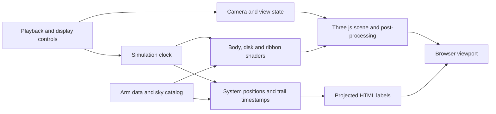

# Galactic Motion

Galactic Motion is a browser-based 3D explorer of the Milky Way. Follow the Solar System, Alpha Centauri, Sirius, and TRAPPIST-1 around the galactic center, inspect their local orbits and trailing paths, or switch to the Sky atlas to look outward from the Sun’s neighborhood.

The app combines an illustrative, data-informed galactic model with real photographs and cataloged sky directions. Simulation seconds, displayed star-system positions, body sizes, and telescope-image sizes are chosen for exploration.

## Which Milky Way am I seeing?

The **3D disk** and the **photographic band** are two views of the same galaxy. In the screenshot that prompted this clarification, the wide, pale band with dark streaks comes from ESO’s 360° photograph of the sky **as seen from Earth inside the Milky Way**. The pale light is the combined light of the disk’s stars, and the bright central region is the galactic bulge. Dark lanes come from foreground dust absorbing starlight. Glowing nebulae and stars also appear in the image. [ESO’s Milky Way panorama](https://www.eso.org/public/images/eso0932a/)

The app keeps those perspectives in separate modes.

| View | What the camera shows | What appears behind it |
| --- | --- | --- |
| Galaxy overview and North view | The modeled 3D disk, central bar, named arms, the four systems, and optional reference rings | A dark sky, optional decorative star points, and optional telescope portraits at catalog-derived directions |
| System close-up | A moving camera follows a system’s barycenter while its planets or companion stars trace their paths through the modeled disk | The same modeled disk and background layers as the overview, with the procedural dust dimmed |
| Sky atlas | A catalog direction as seen from the Sun’s neighborhood | The optional ESO sky photograph and an optional enlarged telescope portrait of the selected object |
| Static preview | An illustrated galaxy image while the renderer loads or when WebGL 2 is unavailable | The packaged preview image |

The ESO photograph is drawn only in the Sky atlas. It loads on first use with **All-sky photograph in atlas** enabled. The points in **Decorative stars** come from a seeded procedural star field. The six telescope portraits are individual image layers, and the rest of the dotted sky inside the atlas photograph comes from the photograph itself.

## Run locally

Use Node.js 22.12 or later and npm. The package also declares support for Node.js 20.19 through the 20.x series.

```sh
cd ~/Documents/GitHub/Galactic-Motion-Sim
npm ci
npm run dev
```

Open [http://localhost:5173](http://localhost:5173), or follow the address Vite prints when the default port is occupied. Run the commands from the directory containing this project’s `package.json`.

| Command | Purpose |
| --- | --- |
| `npm ci` | Install the exact dependency versions from the lockfile |
| `npm run dev` | Start the local Vite server with hot updates |
| `npm run typecheck` | Check the TypeScript sources without emitting files |
| `npm run build` | Type-check the application and generate static production files in `dist` |
| `npm run preview` | Serve the existing production build locally, usually at port 4173 |

## Deploy to Vercel

Import the repository and select the **Vite** framework preset. Use `npm run build` as the build command and `dist` as the output directory. The project deploys as a self-contained static bundle with local imagery and fonts. [Vercel’s Vite documentation](https://vercel.com/docs/frameworks/frontend/vite)

## Controls and navigation

- **Systems** lists the four animated systems. Select a card or a projected marker to track the corresponding system. Drag to orbit the camera and scroll or pinch to zoom.
- **Galaxy overview** or **G** returns to the oblique view. **North view** looks down onto the disk from galactic north, where clockwise rotation is apparent.
- **Labels** toggles projected names for systems, bodies, the galactic map, and deep-sky objects. Separate arm and deep-sky label switches appear in **Settings**. Labels can move to adjacent positions or disappear when they would overlap or fall outside the viewport.
- **Guided tour** loops every 40 seconds. Interacting with the scene or choosing a system manually returns the camera to free roam.
- **Sky atlas** points the camera toward an object’s catalog coordinates. Drag to look around, use the **Field of view** slider or scroll wheel to zoom, and open **Milky Way map key** for the full list of arm names.
- **Pause simulation** or **Space** freezes the simulation clock while leaving the camera available. Keyboard shortcuts yield to focused form controls and the About dialog. If reduced motion is enabled at startup, playback starts paused and camera transitions snap to their destinations.
- **Reset simulation** restores the timer and scrubber, time scale, trail length, and overview framing. Display settings are independent of the simulation reset.

### Simulation controls

| Control | Default | What it changes |
| --- | --- | --- |
| Time scale | 1× | Advances the simulation clock at 0.25× to 4× in 0.25× steps |
| Trail length | 9 seconds | Changes the sampled history window from 2 to 20 simulation seconds |
| Simulation time | 00:00.0 | Scrubs in tenths of a simulation second. Seeking pauses playback and ends a guided tour. The range starts at 60 seconds and expands in 60-second increments as playback reaches its end. |
| Trail timestamps | On | In a focused system’s galactic frame, marks earlier times along the dashed barycenter path. Negative timestamps are samples from before the clock’s zero. |
| Trail reference frame | Galactic path | **Galactic path** includes the system’s travel around the Milky Way. **System-centered orbits** holds the selected barycenter fixed in the trail history. |
| Orbit trails | On | Shows or hides the ribbons and their time guides. The bodies continue moving. |
| Galactic reference rings | On | Shows or hides the concentric map guides used in overview and North view |

### Visual settings

| Control | Default | What it changes |
| --- | --- | --- |
| Bloom intensity | 69% | Brightens luminous pixels with an HDR bloom pass on supported GPUs. At 0%, the pass is skipped. |
| Galactic dust | 100% | Scales the brightness of the procedural disk clouds and core glow |
| Render quality | Auto | Chooses adaptive resolution, Performance, or High detail |
| Spiral arm labels | On | Shows named structures when viewing the full modeled disk |
| Deep-sky labels | On | Shows names for visible catalog objects |
| All-sky photograph in atlas | On | Shows the ESO panorama when an atlas object is selected |
| Telescope close-ups | On | Shows the enlarged galaxy portraits in the atlas and as optional background objects in model views |
| Decorative stars | On | Draws procedural star points behind the modeled disk |
| Field of view | Object-specific | Changes the atlas camera’s vertical field of view from 3° to 60° |

The FPS counter in the upper right reports measured animation frames per second, independently of the simulation’s 120 Hz clock.

## Technology stack

| Technology | Role |
| --- | --- |
| TypeScript 5.9 | Strictly typed application code, compiled for ES2022 with bundler module resolution |
| Vite 8 and Rolldown | Development server, production bundling, and asset processing. The 3D simulator loads dynamically, and Three.js core is split into its own chunk. |
| Three.js r184 | WebGL renderer, scene graph, cameras, matrices, instanced geometry, texture loading, and built-in post-processing |
| WebGL 2 and GLSL ES 3.00 | GPU evaluation of orbital paths, star motion, procedural dust, planet surfaces, and sky-image projection |
| `OrbitControls` | Drag, wheel, and touch camera input with damping, a movable target, and scene-dependent zoom behavior |
| `EffectComposer`, `RenderPass`, `UnrealBloomPass`, `SMAAPass`, `OutputPass` | Render the HDR scene, diffuse bright regions, smooth edges, and apply ACES filmic tone mapping with sRGB output |
| HTML, CSS, native DOM events and ranges | Responsive controls, accessible buttons and settings, an About dialog, projected labels, the time scrubber, and viewport overlays |
| Fontsource, DM Sans and Space Grotesk | Self-hosted Latin-subset variable fonts for the interface |
| WebP | Local, compressed sky photographs, telescope portraits, and the static preview |
| OpenAI ImageGen | Created the illustrated startup and fallback image during development. The atlas uses the credited observations below. |
| Node.js and npm | Local development, package management, and production builds |
| Vercel | Static hosting for the compiled Vite output |

## How the simulation works



### World coordinates and galactic motion

The `XZ` plane is the galactic disk, the origin is the galactic center, and positive `Y` points toward galactic north. A system’s center follows a circular path with sinusoidal vertical motion. The model uses a flat rotation curve of 5.3 scene units per simulation second, so systems farther from the center have smaller angular speeds.

```text
theta(t) = theta0 + (galacticSpeed / R) * t
center(t) = (
  R * cos(theta(t)),
  verticalAmplitude * sin(verticalRate * t + verticalPhase),
  R * sin(theta(t))
)
```

A rising angle moves from positive `X` toward positive `Z`, which appears clockwise from the north pole. The disk particles follow the same direction and use a lower bound on the radius in the angular-speed calculation to keep the core stable. The arm and bar pattern advances independently at 0.009 radians per simulation second.

### Named spiral structure

The model uses the Sun’s starting radius of 132 scene units as the scale reference for 8.15 kiloparsecs. Galactic azimuth is measured from the initial Sun–center line in the direction of rotation. Within the fitted intervals, each arm’s centerline comes from a piecewise logarithmic spiral around the radius and azimuth of its fitted bend.

```text
R(beta) = Rkink * exp(-(beta - betaKink) * tan(pitch))
```

The renderer evaluates the two pitch angles on the appropriate sides of the bend. It continues shortened fits with tapered, broader arms on the far side. The **Norma**, **Scutum–Centaurus**, **Sagittarius–Carina**, **Perseus**, and **Outer** arms and the **Orion Spur (Local Arm)** draw on the measured segments in Reid et al. The near and far **3-kpc arms** are schematic inner gas lanes. The central bar starts about 30° from the Sun–center line, and the **Sagittarius A*** marker indicates the galactic center. The styling of the clouds and the far-side continuations are illustrative. [Reid et al. (2019), Table 2](https://arxiv.org/abs/1910.03357) · [Wegg et al. (2015)](https://doi.org/10.1093/mnras/stv745) · [NASA’s Milky Way illustration](https://science.nasa.gov/resource/the-milky-way-galaxy/)

`spiral-map.ts` rasterizes these profiles into a 512 × 256 polar data texture. Its channels encode arm ridges, broader halos, and offset dust lanes. The disk-point and dust shaders sample the same texture. A seeded generator lays out the bulge and disk stars, and three horizontal shader layers use fractal noise to break up the gas, absorption lanes, and glowing knots.

### Local orbits and surface rotation

Each body adds one or two circular offsets to the system’s moving center. The local basis comes from the system’s initial galactic azimuth and stays fixed as the system travels. If `T` is the initial tangent, `N` the inward radial direction, and `B` the down direction, each circular offset is evaluated as follows.

```text
phase(t) = angularSpeed * t + phase0
offset(t) = orbitRadius * (
  cos(phase(t)) * N +
  sin(phase(t)) * (cos(inclination) * B + sin(inclination) * T)
)
body(t) = center(t) + offset(t) + optionalOuterOffset(t)
```

| System | Bodies | Local motion in the model |
| --- | --- | --- |
| Solar System | The Sun and eight planets | A central star and inclined planetary circles with separate radii, periods, colors, and starting phases |
| Alpha Centauri | A, B, and Proxima | A close pair on opposite phases with a shared outer displacement. Proxima follows a wider offset in the opposite phase. |
| Sirius | Sirius A and Sirius B | A barycentric pair with opposite phases and unequal orbital radii |
| TRAPPIST-1 | The star and planets b through h | Seven planetary circles with periods based on their observed ordering and ratios, compressed for the display |

Stars use luminous billboards with halos and diffraction spikes. In close-up, planet billboards reconstruct a lit disc and shade procedural rocky or banded surfaces. Saturn’s ring is projected from its spin axis. The Solar System’s axial tilt values come from NASA, including the retrograde spin of Venus and Uranus. Spin rates, the orientations of the axes within the orbital planes, and the atmosphere and surface patterns are illustrative. [NASA Planetary Fact Sheet](https://nssdc.gsfc.nasa.gov/planetary/factsheet/index.html)

The four featured systems have 22 rendered bodies in total. Their exaggerated galactic separations keep each selectable in the overview. The renderer evaluates motion from closed-form equations. The circular paths, fixed orbital planes, vertical oscillation, and shared galactic rotation curve are approximations.

### Clock, trails, and timing

The clock represents time as 1/120-second ticks plus a fractional remainder. Each animation callback advances it by elapsed browser time, multiplied by the selected rate. Raw playback deltas are capped at 0.05 seconds, and hidden tabs skip animation work. A seek sets the clock directly and reevaluates the scene at the selected time.

The GPU draws one instanced ribbon mesh and one instanced body mesh across the four systems. Each ribbon strip has 512 samples, two vertices per sample, and indexed triangles. The vertex shader evaluates each point at `time − age × trailLength`. A nearby sample estimates the screen-space tangent so the strip can widen perpendicular to the path. The fragment shader tapers the tail and boosts brightness near the body. The renderer recomputes paths analytically, so trail memory stays fixed even as playback time grows.

Every 128 simulation seconds, the renderer moves the shader’s time origin forward and rebases its phase attributes. That keeps the GPU time values small while the UI and CPU positions continue using absolute simulation time. Seeking backwards also updates the shader’s time origin.

In the system-centered view, the selected system’s past barycenter is subtracted and its current barycenter is added. The ribbons then show the local offsets around one center. Simple single-offset orbits are capped at one revolution in this view to limit brightness from overlapping loops. A separate 60-sample dashed guide and up to four projected timestamps show the barycenter’s past positions in the galactic frame.

### Camera and tour

The simulation camera uses a perspective projection and damped orbit controls. During system tracking, the CPU evaluates the barycenter using the same galactic equations as the GPU and translates the camera and its target by the barycenter’s movement. Camera transitions ease over approximately 1.55 seconds, and the user can interrupt a model-view transition by interacting with the canvas.

| Guided tour time | Camera target |
| --- | --- |
| 0–4 seconds | Milky Way overview |
| 4–12 seconds | Solar System |
| 12–19 seconds | Alpha Centauri |
| 19–25 seconds | Sirius |
| 25–29 seconds | TRAPPIST-1 |
| 29–40 seconds | Return to the overview |

The tour runs on camera time. Changing simulation speed scales the orbits and trail clock while the tour keeps its camera pacing. The Sky atlas switches to a near-Sun viewing direction and changes the camera’s vertical field of view for zoom.

### Labels and render quality

The CPU samples system and body positions for the labels, projects them through the camera, and positions HTML callouts in screen space. The callout layout reserves rectangles for occupied labels, tries offsets on either side of each projected position, and draws the connector back to the point. The labels and controls remain in CSS pixels as the WebGL resolution changes.

Auto quality starts with a budget of roughly 1.75 million render pixels and monitors a smoothed frame duration. Under sustained load it steps down the effective device-pixel ratio. At lower scales it also reduces disk particle density and the number of visible dust layers. **Performance** targets roughly 950,000 render pixels, draws 75,000 disk particles, uses one dust layer, and skips SMAA. **High detail** targets up to roughly 3 million render pixels with 150,000 disk particles and three dust layers. The optional decorative field contains 10,000 seeded star points.

HDR-capable WebGL 2 devices use floating-point render targets for bloom and subpixel morphological antialiasing (SMAA). The compatible fallback uses an 8-bit render target. If the WebGL context cannot start or is lost, the app displays the static preview and disables the simulation controls.

## Sky atlas data and imagery

The catalog stores ICRS right ascension and declination in degrees, a display name, an approximate distance, a default field of view, an image aspect ratio, and image credits. The coordinate conversion rotates each equatorial unit vector into the IAU galactic frame. The renderer then expresses that direction in the app’s `XZ` disk and `+Y` north convention. The Milky Way model uses illustrative separations for its four animated systems. The atlas uses catalog directions for the objects below. [NASA/IPAC coordinate lookup](https://irsa.ipac.caltech.edu/applications/Lookup/) · [CDS SIMBAD](https://simbad.cds.unistra.fr/simbad/)

| Object | Catalog ID | Approximate distance | Image credit |
| --- | --- | --- | --- |
| Andromeda Galaxy | M31 | 2.5 million light-years | NASA/JPL-Caltech/UCLA. [WISE portrait](https://science.nasa.gov/photojournal/our-neighbor-andromeda/) |
| Triangulum Galaxy | M33 | 3 million light-years | NASA/JPL-Caltech/UCLA. [WISE portrait](https://science.nasa.gov/photojournal/wise-spies-a-galactic-neighbor/) · [Distance](https://science.nasa.gov/mission/hubble/science/explore-the-night-sky/hubble-messier-catalog/messier-33/) |
| Large Magellanic Cloud | LMC | 160,000 light-years | NASA/JPL-Caltech/STScI. [Spitzer portrait](https://science.nasa.gov/photojournal/our-chaotic-neighbor/) · [Distance](https://science.nasa.gov/earth/earth-observatory/the-galaxy-next-door/) |
| Small Magellanic Cloud | SMC | 200,000 light-years | NASA/JPL-Caltech/UCLA. [WISE portrait](https://science.nasa.gov/photojournal/wises-view-of-a-wispy-cloud/) |
| Bode’s Galaxy | M81 | 12 million light-years | NASA/JPL-Caltech/ESA/Harvard-Smithsonian CfA. [Multi-wavelength portrait](https://science.nasa.gov/photojournal/m81-galaxy-is-pretty-in-pink/) |
| Sombrero Galaxy | M104 | 28 million light-years | NASA, and the Hubble Heritage Team (STScI/AURA). [Hubble portrait](https://science.nasa.gov/asset/hubble/sombrero-galaxy/) |

The atlas maps **ESO/S. Brunier**’s photographic panorama to the inside of a camera-centered sphere. A small rotation registers the photograph against Andromeda, Sirius, Canopus, and the Magellanic Clouds. The shader then converts each sky direction into longitude and latitude texture coordinates. The panorama is resized and reprojected here. [Original ESO panorama](https://www.eso.org/public/images/eso0932a/) · [CC BY 4.0](https://creativecommons.org/licenses/by/4.0/)

Telescope portraits are center-cropped, resized, and drawn as edge-blended billboards centered on their catalog directions. They use illustrative sizes and brightness, and the atlas masks the wider photograph around the selected portrait to avoid showing a second image of the same target. To see the object’s surroundings in the photographic sky, turn off **Telescope close-ups** and leave **All-sky photograph in atlas** enabled.

## Source layout

| File | Responsibility |
| --- | --- |
| [`index.html`](index.html) | Viewport, systems panel, atlas catalog, settings, keyboard help, and static fallback layout |
| [`src/main.ts`](src/main.ts) | DOM setup, controls, display state, guided tour, catalog navigation, image credits, and WebGL status |
| [`src/simulator.ts`](src/simulator.ts) | Scene orchestration, camera transitions, render pipeline, label updates, FPS measurement, and quality adaptation |
| [`src/systems.ts`](src/systems.ts) | Data for the four animated systems and CPU position sampling |
| [`src/orbits.ts`](src/orbits.ts) | Instanced body billboards, screen-space ribbons, orbital shaders, and time rebasing |
| [`src/spiral-map.ts`](src/spiral-map.ts) | Named arm definitions, profile fitting rules, polar texture data, and map anchors |
| [`src/galaxy.ts`](src/galaxy.ts) | Disk particles, decorative stars, procedural dust, star glints, and map rings |
| [`src/sky-catalog.ts`](src/sky-catalog.ts) | Catalog entries, ICRS-to-galactic conversions, and directions in scene coordinates |
| [`src/deep-sky.ts`](src/deep-sky.ts) | Telescope billboards, panorama projection and masking, and atlas-only panorama loading |
| [`src/clock.ts`](src/clock.ts), [`src/timeline.ts`](src/timeline.ts), [`src/trail-axis.ts`](src/trail-axis.ts) | Simulation time, seek UI, and the dashed timestamp guide |
| [`src/callouts.ts`](src/callouts.ts), [`src/icons.ts`](src/icons.ts), [`src/style.css`](src/style.css) | Projected label layout, interface icons, and responsive styling |
| [`src/view-settings.ts`](src/view-settings.ts) | Display settings and their defaults |
| [`public/sky/`](public/sky/) and [`public/galaxy.webp`](public/galaxy.webp) | Local derived WebP sky assets and the illustrated loading and fallback view |
| [`package.json`](package.json), [`package-lock.json`](package-lock.json), [`tsconfig.json`](tsconfig.json), [`vite.config.ts`](vite.config.ts) | Toolchain, locked dependency versions, type checking, and bundler configuration |

## Verify a build

Run `npm run build`, then `npm run preview` to check the production output. In the overview, rotate the disk and select each featured system. Check that labels and timestamps follow the model, the timeline seeks and pauses, and both trail reference frames work. In **Sky atlas**, select Andromeda and toggle **All-sky photograph in atlas**. The photo layer and its credit should toggle there. Return to the overview and verify that the 3D galaxy, decorative stars, and optional galaxy portraits are the visible layers. Resize to a phone-width viewport and check that the controls still fit.
